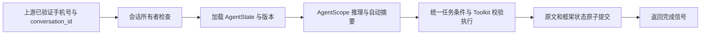

# 会话状态、用户隔离与框架接续

用户确认：上游平台完成身份验证，通过已有请求 user 字段传入可信手机号。本服务负责该身份下的会话授权；不新增登录系统，不把任意公网自报手机号视作完成鉴权。部署入口必须仍受可信上游控制。

## 已确认的问题

- 最近20条限制作用于数据库保存，通常只留下10轮，混淆了留存和模型预算。
- 列表按 user_id 过滤，读取、续聊、详情、删除及并发写入没有完整的一致所有者检查。
- 每个 HTTP 请求新建 Agent 本身适合无状态服务；缺陷是没有恢复 AgentState.summary/context/tasks_context。
- 框架默认摘要会调用模型，项目新增字符裁剪却先丢弃上下文，且模型中间件预算没有覆盖框架直接发起的摘要调用。
- v2 任务快照仍依附助手消息，补参在中间件和 Toolkit 分散；旧直出实现还保留了等待下轮模型的备用分支。

## 选择

继续把摘要塞进消息或进程缓存虽然部署简单，但仍混淆持久化职责或无法支持多进程/重启。采用独立 agent_session_states 表保存公开 AgentState 的可续接字段，原 Conversation.messages 留作用户可见问答记录。新增表，不改现有列；提供可重复执行的离线 DDL，无内网新依赖。

请求流程：可信 user → 所有者检查 → 读取状态 → AgentState.model_validate 恢复 → 框架推理/自动摘要/Toolkit → 正常完成后原文与新状态同一事务保存。摘要失败、工具协议失败或中断不得覆盖已提交状态；并发旧版本提交必须失败，不能静默覆盖新上下文。

## 状态边界

- 原文：不再固定20条丢弃，明确删除会话时才删除其原文和状态。已有被删除的旧记录无法凭本地恢复。
- 模型工作状态：summary、context、tasks_context，用框架公开序列化恢复；不恢复上轮迭代计数、权限许可、通用中间件缓存或文件工具缓存。
- 业务任务条件：以框架 Task.metadata 保存结构化目标和已校验参数及上次执行状态，HTTP 间不靠重读助手正文恢复。旧 agent_context 仅作为迁移兼容读取。
- 长期用户偏好：本轮不接入跨会话语义检索，地区/指标不能自动成为其他会话默认条件。

## 框架与业务分工

保留 AgentScope 原生 Agent、AgentState、Task、ContextConfig、ReAct、Toolkit、Schema、事件和压缩钩子。摘要使用框架现有压缩功能，显式配置 token 比例及业务摘要提示；删除自制字符裁剪。业务目标/范围防扩大、确定性报告直出、协议防外泄和等待预算属于项目约束，需要保留。合并重复补参到工具入口，清理旧直出后备链路，不删除专业工具和 SQL 规则。

## 验收

使用真实框架验证：摘要触发后产生 summary、状态序列化恢复后不重复拼接全文；重启等价的新 Agent 仍能连续追问；不同用户无法读取、续聊或删除另一用户的会话；超过20条原文仍保留；旧版本并发保存被拒绝；正常报告、流式错误和原有工具回归不退化。目标 PostgreSQL 和上游真实模型仍需内网验收。

## 实现与配置

conversation_id 仍是全局唯一主键，代表一段完整对话；user_id 是所属用户标识，不会每轮生成新的会话。上游 user 对应手机号，列表/详情/删除使用相同 user_id。仅新建对话生成 UUID。

默认压缩触发比例0.75，保留近期上下文比例0.2，工具结果限制8000 tokens，Agent主模型推理及摘要累计等待60秒。配置基于当前32768窗口预留空间，不能据此认定生产网关窗口或推理性能已验证。工具内部通用SQL规划模型仍有自身调用限制，不属于这个主模型预算；没有宣称整条请求固定60秒。

已删除 BusinessToolInputMiddleware、字符预算裁剪、条件转文字再重新解析的范围恢复、旧直出等待下轮模型的分支、数据库20条截断。条件合并与范围检查位于工具入口，共享请求入口解析结果；旧 assistant.agent_context 只兼容读取。原生 AgentState 及 Task 保存到独立表。

启动会只读验证必要会话表，必要结构不存在或不可读时不再宣称服务就绪；写权限仍需目标环境验证。原文和状态更新同一事务，版本冲突回滚整组问答；删除与保存使用一致锁顺序。流式完成信号在落库后返回，持久化冲突按失败记录指标。

生产使用受限数据库账号：`DB_AUTO_CREATE_TABLES=false` 为默认值，启动不执行 DDL。管理员在实际 DB_NAME 中执行 `db/agent_session_state.sql`，再按需执行 `db/agent_session_grants.sql`，仅给会话表授予 SELECT/INSERT/UPDATE/DELETE 以及 schema USAGE，不需要 schema CREATE。开发环境需显式设为 true 才自动建表。2026-10-29 新日志是建表权限被拒绝后发现新表不存在，尚未进入写入流程，不能据此认定 INSERT 权限不足。只读 ACL 自检不替代真实写入及行级策略验收。

远端只读 inspect 输出确认宿主目录 `/home/sunlu/energy_agent/docker_run/energy_agent_v1` 绑定 `/app`，Uvicorn 未启用 reload。代码可通过宿主机完整替换后重启进程加载，无需为本轮代码重建镜像；新增依赖仍需重新准备镜像。本仓库 Compose 使用相对项目根目录挂载，需将 Compose 放在同一项目根目录再使用；本轮不自动重建生产容器，不开启自动 reload。整目录替换先停容器，保留 `.env`、日志、导出文件及生产定制目录。交付为完整源码目录 ZIP，不再使用仅含变更文件的目录覆盖。

原文仍使用已有 Conversation.messages JSON，适用于当前内部会话规模；长期归档策略、海量消息分页及文件下载授权是独立工作，不能把本次会话隔离当成完整数据权限系统。已被旧版20条机制删除的本地记录不会自动恢复。

### 同日生产部署补充：依赖检查与进程存活分离

后续日志确认重启后在首次 TCP 连接 `10.159.55.51:5432` 超时，尚未执行 SQL。数据库 URL 与引擎构造未改变；新版严格启动检查将异常传播，导致 HTTP 进程退出。用户在独立内网机器经 U 盘部署，重复搬运排查命令成本高；继续部署更新，不回退为旧版。

启动检查改为有界探测与后台恢复：初次最多5秒，失败每5秒重试，正常每30秒只读复查；HTTP 页面存活，未就绪业务请求统一503，健康接口也返回503，只有连接及必要表检查通过才放行。页面展示安全状态并自动刷新。保留框架状态表、事务保存、用户隔离及默认不建表；不吞掉依赖故障后冒充健康。存活不代表业务已恢复，真实模型、SQL 与写入仍须内网验收。提供完整目录发布包及一次执行的部署脚本，自动校验、备份、替换、重启、记录结果；不重建容器或改变网络/配置。详见[启动恢复部署说明](../../deployment/2026-10-29-startup-recovery.md)。

### 同日问候语延迟

用户确认容器选错导致前述连接故障，修正容器后数据库正常。新的“你好”日志中，上下文检查1.14ms且未生成摘要，模型一次调用14298.02ms、输入3865 tokens、输出222 tokens并生成一个工具调用。代码已将完整问候短句限定到固定能力说明工具，却仍请求模型输出该确定调用；主要延迟来自这次多余的模型往返。日志不足以细分模型排队、首 token、预填充和生成耗时。

复用原有短句判定与 ExecutionPolicy，在已经限定为 answer_general_guidance、工具已注册且空参数通过 Schema 校验时生成原生 ToolCallBlock，继续经过 Toolkit、直出、事件与持久化。此轮不需要远程推理，摘要压缩延后到下一轮业务；不清空历史摘要。包含实际业务目标的问候前缀不命中本地说明，不扩展业务规则名单。日志 fixed_guidance_local 明确 remote_model_calls=0；AgentScope 的逻辑模型阶段事件仍可能出现，不等于访问了模型服务。不改模型网关、数据库或容器配置。

### 同样的新对话请求再次失败

后续三次同问题均 cid 为空，排除这三次请求由旧会话状态恢复触发。首次工具正常执行，后两次模型给出工具调用但未进入业务函数，第二次模型请求400，提示 JSONDecodeError。SDK解析工具输入失败后仍保留原 ToolCallBlock，OpenAI格式器原样发送参数。本地以空白工具参数复现相同400路径，生产坏参数原文未知，不能逐字确认。

在 ExecutionPolicy 的完整模型响应边界验证原生参数为 JSON 对象；流式只验证完整末块。坏响应未进入 AgentState 前按原问题干净重试一次，失败即模型协议错误，不猜参数、不查库；原累计等待预算仍生效。只重试尚未执行的模型规划，不重跑成功工具。重试用量并入事件总 token，单次输入峰值单独保留。已验证首次正常、之后两次坏参数后纠正均只执行一次业务工具；持续错误、非对象JSON、流分块及预算耗尽均安全终止。见[工具参数部署说明](../../deployment/2026-10-29-tool-arguments.md)。

